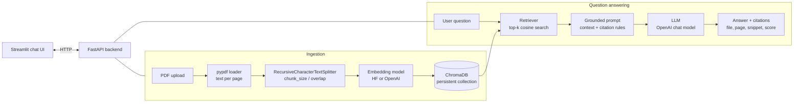

# DocuMind: RAG-Based Document Q&A Assistant

[](https://github.com/rajanSaini12/documind-rag/actions/workflows/ci.yml)


DocuMind lets you upload PDFs and ask questions about them in plain English. Every answer
cites the file and page it came from, e.g. `[handbook.pdf p.3]`. When the documents don't
contain the answer, it says *"I don't know based on the documents."* instead of making
something up.

It is a Retrieval-Augmented Generation (RAG) pipeline built with **LangChain** and
**ChromaDB**, served through a **FastAPI** backend with a **Streamlit** chat UI, packaged
with **Docker Compose**, and shipped with an **evaluation harness** that compares embedding
models and chunk sizes on retrieval quality, answer relevance, faithfulness and refusal
behaviour.

> Built by **Rajan Kumar Saini** ([@rajanSaini12](https://github.com/rajanSaini12)) as a
> learning and portfolio project.

---

## Features

- **PDF ingestion:** page-aware text extraction (pypdf), recursive chunking with configurable
  size and overlap, embeddings stored in a persistent Chroma collection with `source`,
  `page`, `doc_id` and `chunk_id` metadata.
- **Multiple documents:** upload, list and delete documents. Re-uploading the same file is
  detected through a content hash.
- **Grounded answers with citations:** the prompt restricts the LLM to the retrieved context,
  requires `[file p.N]` citations, and defines a fixed refusal phrase. The API returns the
  supporting chunks (file, page, snippet, similarity score) and marks which ones the answer
  actually cited.
- **Pluggable models:** Hugging Face sentence-transformers (e.g. `all-MiniLM-L6-v2`,
  `bge-small-en-v1.5`) or OpenAI embeddings; an OpenAI chat model with a configurable name.
  Everything is set through `.env`.
- **Offline mode:** deterministic hashing embeddings plus an extractive fake LLM, so tests,
  CI and demos run with no network and no API key.
- **Evaluation harness:** a grid over embedding models and chunk sizes reporting hit rate@k,
  MRR, relevance, faithfulness (LLM-as-judge or a lexical fallback), and correct/false
  refusal rates. Results are written to CSV and Markdown with Pandas.
- **Production basics:** typed Pydantic schemas, input validation (type, size, path
  stripping), meaningful HTTP errors, health check, non-root Docker images, persisted volumes,
  ruff and pytest in GitHub Actions.

## Architecture



## Tech stack

| Area | Tools |
|---|---|
| Language | Python 3.11+ |
| LLM framework | LangChain (`langchain-core`, `langchain-text-splitters`, `langchain-chroma`, `langchain-openai`, `langchain-huggingface`) |
| Vector database | ChromaDB (persistent, cosine distance) |
| Embeddings | Hugging Face sentence-transformers / Transformers, OpenAI embeddings |
| LLM | OpenAI API (chat models, e.g. `gpt-4o-mini`) |
| Backend | FastAPI, Pydantic, Uvicorn |
| UI | Streamlit |
| Evaluation | Pandas, NumPy, LLM-as-judge |
| Tooling | Docker Compose, pytest, ruff, GitHub Actions |

## Project structure

```
documind-rag/
├── src/documind/
│   ├── config.py          # settings from env/.env (pydantic-settings)
│   ├── ingestion.py       # PDF -> pages -> chunks
│   ├── vectorstore.py     # Chroma wrapper: add/list/delete documents, search
│   ├── prompts.py         # grounding prompt, citation formatting/parsing
│   ├── rag.py             # retrieve -> prompt -> LLM -> answer + citations
│   ├── providers.py       # embedding / LLM factories (HF, OpenAI, fake)
│   ├── fakes.py           # offline hashing embeddings + extractive fake LLM
│   ├── api/               # FastAPI app and request/response schemas
│   └── eval/              # dataset loader, metrics, judges, grid runner
├── app/streamlit_app.py   # chat UI (talks to the API via BACKEND_URL)
├── scripts/
│   ├── evaluate.py        # evaluation CLI
│   └── make_sample_pdf.py # generates the fictional sample handbook
├── eval/
│   ├── qa_dataset.jsonl   # 12 questions (3 unanswerable) with gold pages
│   ├── sample_docs/       # handbook.pdf (generated, fictional content)
│   └── results/           # evaluation outputs
├── tests/                 # offline pytest suite
├── docker/                # api.Dockerfile, ui.Dockerfile
└── docker-compose.yml
```

## Quick start

### Option A: Docker Compose

```bash
cp .env.example .env        # then set OPENAI_API_KEY
docker compose up --build
```

- UI: http://localhost:8501
- API docs (Swagger): http://localhost:8000/docs

The Chroma data and the downloaded Hugging Face model are stored in named volumes
(`chroma_data`, `model_cache`), so they survive restarts. The first start downloads the
embedding model, so it takes a little longer.

### Option B: Run locally

```bash
python -m venv .venv && source .venv/bin/activate
pip install -e ".[dev,hf]"   # 'hf' installs sentence-transformers (PyTorch)
cp .env.example .env         # set OPENAI_API_KEY

uvicorn documind.api.main:app --reload       # terminal 1: http://localhost:8000
streamlit run app/streamlit_app.py           # terminal 2: http://localhost:8501
```

### Option C: Try it with no API key (offline demo)

```bash
pip install -e ".[dev]"
EMBEDDING_PROVIDER=fake EMBEDDING_MODEL=hashing-384 LLM_PROVIDER=fake \
  uvicorn documind.api.main:app
```

The fake models are simple keyword matchers. They show that the full pipeline works, but
their answers are extracted sentences, not generated ones.

### Example API calls

```bash
curl -F "file=@eval/sample_docs/handbook.pdf" http://localhost:8000/documents
curl -X POST http://localhost:8000/ask -H "Content-Type: application/json" \
     -d '{"question": "How many days of annual leave do I get?", "top_k": 4}'
```

## Configuration

All settings are environment variables (or entries in `.env`):

| Variable | Default | Description |
|---|---|---|
| `EMBEDDING_PROVIDER` | `huggingface` | `huggingface`, `openai` or `fake` |
| `EMBEDDING_MODEL` | `sentence-transformers/all-MiniLM-L6-v2` | e.g. `BAAI/bge-small-en-v1.5`, `text-embedding-3-small`, `hashing-384` |
| `LLM_PROVIDER` | `openai` | `openai` or `fake` |
| `LLM_MODEL` | `gpt-4o-mini` | Any OpenAI chat model name |
| `LLM_TEMPERATURE` | `0.0` | Kept at 0 for factual, repeatable answers |
| `OPENAI_API_KEY` | - | Required when either provider is `openai` |
| `CHUNK_SIZE` | `512` | Max characters per chunk |
| `CHUNK_OVERLAP` | `64` | Characters shared between neighbouring chunks |
| `TOP_K` | `4` | Chunks retrieved per question (overridable per request) |
| `CHROMA_DIR` | `./chroma_data` | Where Chroma persists data |
| `CHROMA_COLLECTION` | `documind` | Base collection name (suffixed with the embedding model) |
| `MAX_UPLOAD_MB` | `20` | Upload size limit |
| `BACKEND_URL` | `http://localhost:8000` | Used by the Streamlit UI |

Each embedding model gets its own collection (e.g. `documind-huggingface-all-minilm-l6-v2`),
because vectors from different models are not comparable. Switching models therefore
starts from an empty collection, so re-upload your documents afterwards.

## API

| Method | Path | Description |
|---|---|---|
| `GET` | `/health` | Status, active models, document and chunk counts |
| `POST` | `/documents` | Upload a PDF (multipart `file`). `201` with doc info; `409` duplicate, `413` too large, `415` not a PDF, `422` unreadable or no text |
| `GET` | `/documents` | List uploaded documents |
| `DELETE` | `/documents/{doc_id}` | Delete a document and all its chunks (`404` if unknown) |
| `POST` | `/ask` | Body `{"question": str, "top_k": int?}` returns `{answer, refused, citations: [{source, page, snippet, score, cited, ...}]}`; `502` if the LLM call fails |

Interactive docs are at `/docs` once the API is running.

## How the RAG pipeline works

1. **Load:** `pypdf` extracts text page by page. Each page becomes a LangChain `Document`
   with `source` and `page` metadata. Pages without text (e.g. scans) are skipped.
2. **Chunk:** `RecursiveCharacterTextSplitter` splits each page separately, so a chunk never
   spans two pages and its page citation is always exact. It tries paragraph breaks first,
   then lines, sentences and words, so chunks usually end at natural boundaries.
   - *Chunk size* is a trade-off. Small chunks give precise retrieval but may cut an answer
     in half. Large chunks keep more context but dilute the embedding and add irrelevant text
     to the prompt. The default is 512 characters, and the evaluation grid exists to test
     this choice.
   - *Overlap* (default 64 characters, about 12%) repeats the end of one chunk at the start
     of the next, so a fact that sits on a split boundary still appears whole in at least
     one chunk.
3. **Embed and store:** each chunk is embedded (normalised vectors) and stored in Chroma with
   `doc_id`/`chunk_id` metadata. Deleting a document removes its chunks by `doc_id`.
4. **Retrieve:** the question is embedded with the same model, and Chroma returns the
   `top_k` most similar chunks by cosine similarity (reported as a 0-1 score). A larger
   `top_k` improves recall but adds noise and token cost; 4 is a reasonable default for
   short documents.
5. **Generate:** retrieved chunks are formatted with a `Source: [file p.N]` header and passed
   to the LLM with a system prompt that says to:
   - answer **only** from the context,
   - cite every claim as `[file p.N]`,
   - reply exactly *"I don't know based on the documents."* when the context lacks the
     answer.
   Temperature is 0. If retrieval returns nothing, DocuMind refuses without calling the LLM.
6. **Cite:** the API parses `[file p.N]` markers from the answer and returns every retrieved
   chunk with `cited: true/false`, so the UI can show exactly which sources back the answer.

The prompt is in [`src/documind/prompts.py`](src/documind/prompts.py), and the chain is
built with LangChain's LCEL as `prompt | llm | StrOutputParser()` in
[`src/documind/rag.py`](src/documind/rag.py).

## Evaluation

The harness answers the question *"which embedding model and chunk size work best for these
documents, and how often does the system hallucinate?"*

**Data:** [`eval/sample_docs/handbook.pdf`](eval/sample_docs/handbook.pdf) is a six-page
employee handbook for a **fictional** company, generated by
[`scripts/make_sample_pdf.py`](scripts/make_sample_pdf.py).
[`eval/qa_dataset.jsonl`](eval/qa_dataset.jsonl) holds 12 hand-written questions: 9 with a
reference answer and gold page, and 3 deliberately **unanswerable** (the handbook says
nothing about them).

**Metrics:**

| Metric | Meaning |
|---|---|
| `hit_rate@k` | Share of answerable questions where a chunk from the gold page is in the top-k results |
| `mrr` | Mean Reciprocal Rank: 1/rank of the first gold-page chunk (1.0 = always ranked first) |
| `relevance` | Does the answer correctly answer the question, compared with the reference answer? (0-1, refusals score 0) |
| `faithfulness` | Share of the answer's claims that are supported by the retrieved context. Low faithfulness means hallucination. Averaged over non-refused answers |
| `false_refusal_rate` | Share of answerable questions where the system said "I don't know" |
| `correct_refusal_rate` | Share of unanswerable questions where the system correctly refused |

**Judges:** with `OPENAI_API_KEY` set, relevance and faithfulness use an **LLM-as-judge**
(prompts in [`src/documind/eval/judges.py`](src/documind/eval/judges.py)): faithfulness
asks the judge to split the answer into claims and count the supported ones. Without a key,
a **lexical fallback** is used: token F1 against the reference answer for relevance, and
"does each answer sentence share at least 80% of its content words with the context" for
faithfulness. The fallback is cheap and deterministic but can't recognise paraphrases, so
treat its numbers as rough.

**Run it:**

```bash
# Real models (needs `pip install -e ".[hf]"` and OPENAI_API_KEY):
python scripts/evaluate.py \
  --embeddings huggingface:sentence-transformers/all-MiniLM-L6-v2 huggingface:BAAI/bge-small-en-v1.5 \
  --chunk-sizes 256 512 1024 --llm-model gpt-4o-mini --judge-model gpt-4o-mini \
  --out-dir eval/results/my_run

# Fully offline (fake models, lexical judge):
python scripts/evaluate.py --offline
```

Outputs: `per_question.csv` (every answer, retrieved pages and scores), `summary.csv`, and
`summary.md`, whose header records the exact models used. **Results depend heavily on the
embedding model, the LLM, the judge and the dataset.** With 12 questions this is a smoke
test for comparing configurations, not a benchmark.

### Results produced so far

Only the **offline** configuration has been run, in a sandbox without access to Hugging
Face or OpenAI. Config: hashing embeddings (256-d and 1024-d bag-of-words, *not* real
semantic models), the extractive fake LLM, the lexical judge, top_k=4, overlap = 12.5% of
chunk size. **Illustrative only.** It shows that the harness runs end to end. It says
nothing about real-model quality. Full output:
[`eval/results/offline_fake/summary.md`](eval/results/offline_fake/summary.md).

| embedding | chunk_size | hit_rate@k | mrr | relevance | faithfulness | false_refusal_rate | correct_refusal_rate |
|---|---|---|---|---|---|---|---|
| fake:hashing-256 | 256 | 1.000 | 0.926 | 0.662 | 1.000 | 0.222 | 1.000 |
| fake:hashing-256 | 512 | 1.000 | 0.944 | 0.774 | 1.000 | 0.111 | 1.000 |
| fake:hashing-256 | 1024 | 1.000 | 0.944 | 0.774 | 1.000 | 0.111 | 1.000 |
| fake:hashing-1024 | 256 | 1.000 | 0.926 | 0.662 | 1.000 | 0.222 | 1.000 |
| fake:hashing-1024 | 512 | 1.000 | 0.944 | 0.774 | 1.000 | 0.111 | 1.000 |
| fake:hashing-1024 | 1024 | 1.000 | 0.944 | 0.774 | 1.000 | 0.111 | 1.000 |

How to read this run: faithfulness is 1.0 by construction, because the fake LLM copies
sentences straight from the context. The false refusals come from the fake LLM's
keyword-overlap threshold. For example, "minimum password length" shares too few words
with "Passwords must be at least 14 characters long". That paraphrase gap is exactly the
kind of thing a real embedding model and LLM are meant to close. Comparing the real
configurations is the next step (see the commands above).

## Testing

```bash
pytest          # 58 tests, fully offline: no network, no API keys, no model downloads
ruff check .    # lint
```

The tests cover chunking and ingestion, retrieval with fake embeddings (multi-document,
delete, persistence), the grounding prompt and citation parsing, refusal behaviour, every API
endpoint (including error cases) through FastAPI's `TestClient`, configuration, and the
evaluation metrics plus an end-to-end offline grid run. CI runs the same checks on Python
3.11 and 3.12.

## Screenshots

> **TODO:** add screenshots of the Streamlit chat (answer with expanded sources) and the
> Swagger UI once running with real models.

## Limitations

- **Text PDFs only:** scanned/image PDFs need OCR, which isn't implemented. Tables and
  multi-column layouts may extract in a messy order.
- **Character-based chunking:** chunk sizes are in characters, not tokens, and the splitter
  doesn't understand headings or sections.
- **Dense retrieval only:** exact terms such as IDs or rare acronyms can be missed by
  embedding search.
- **Citation checking is structural:** the API verifies which retrieved pages the answer
  cites, not whether each cited sentence is truly supported (the eval measures that
  offline).
- **Single-user, no auth:** all uploaded documents share one collection, and document
  listing scans chunk metadata, which is fine for a personal corpus but not for large
  deployments.
- **Small evaluation set:** 12 questions on one synthetic document. Conclusions from it need
  confirming on real data.

## Future work

- Re-ranking retrieved chunks with a cross-encoder (e.g. `bge-reranker`)
- Hybrid search (BM25 + dense vectors) for keyword-heavy queries
- Streaming answers token by token (FastAPI `StreamingResponse` + `st.write_stream`)
- Conversation memory / follow-up question rewriting
- Token-aware and structure-aware chunking (headings, tables)
- OCR for scanned PDFs
- Per-user collections and authentication
- A larger, real-world evaluation set, and tracking eval results over time in CI

## License

[MIT](LICENSE) © 2026 Rajan Kumar Saini
